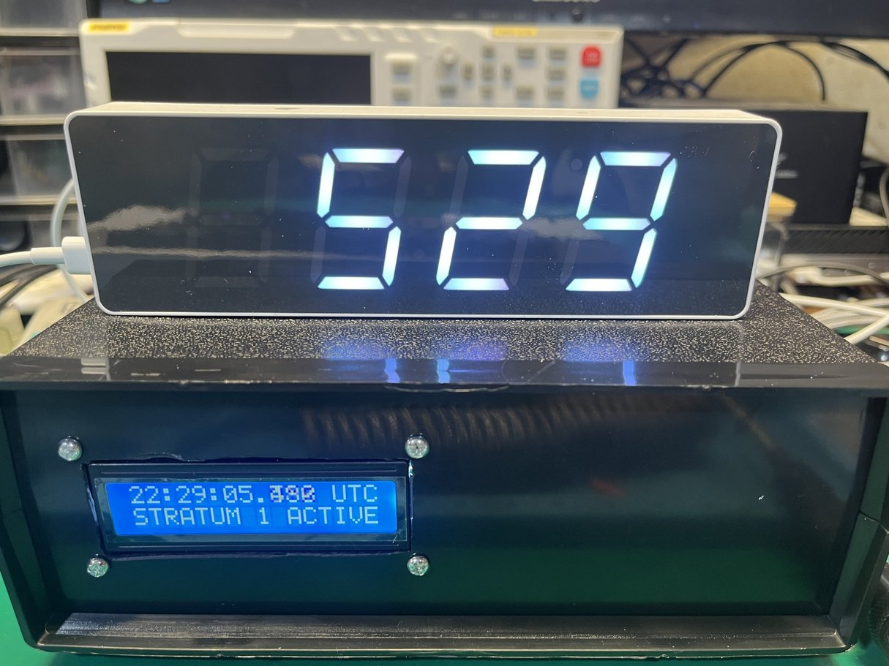
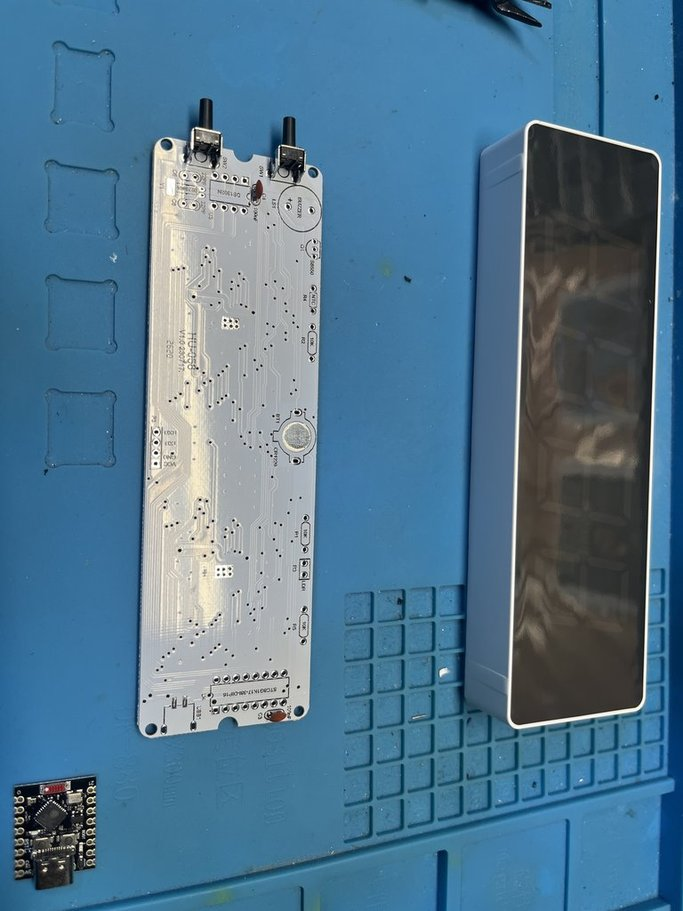
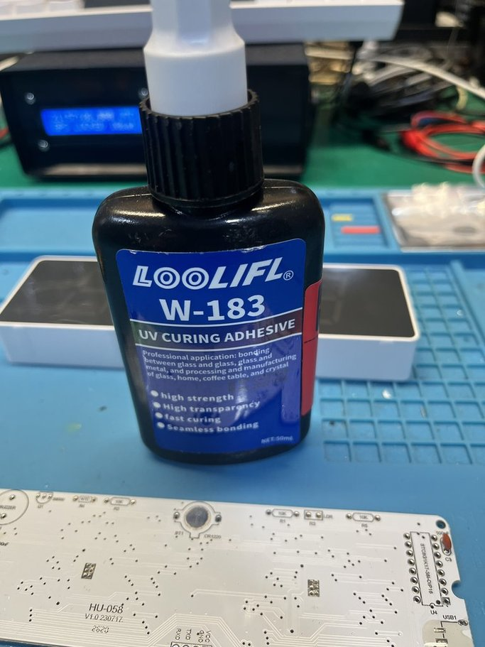
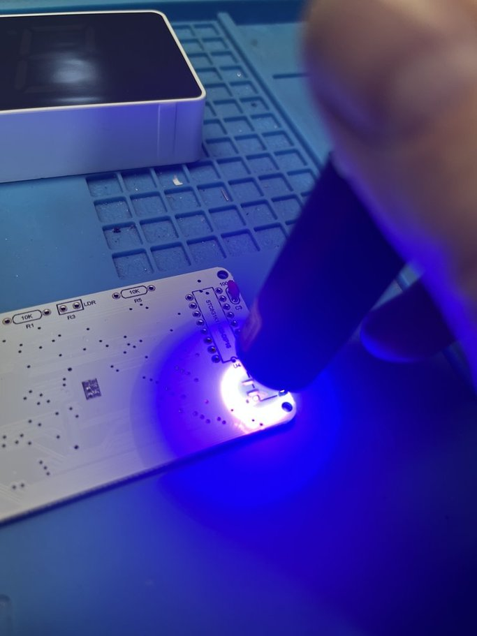
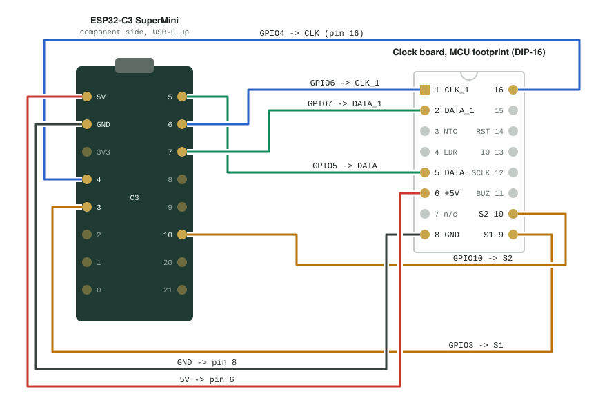
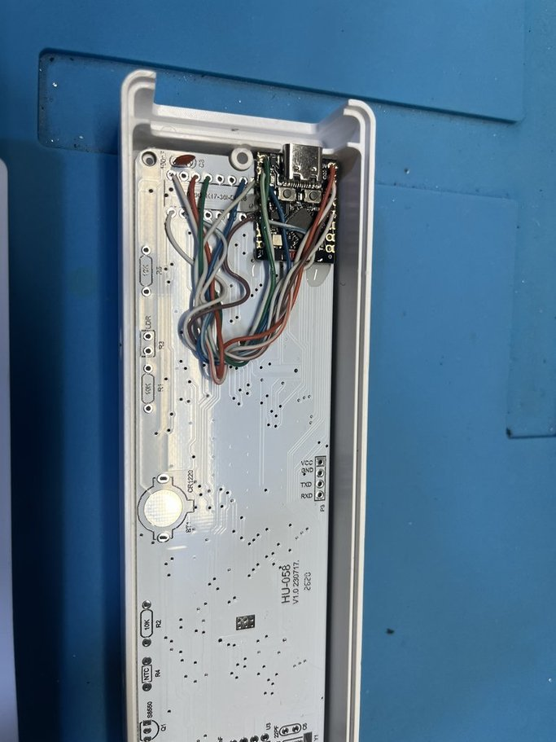
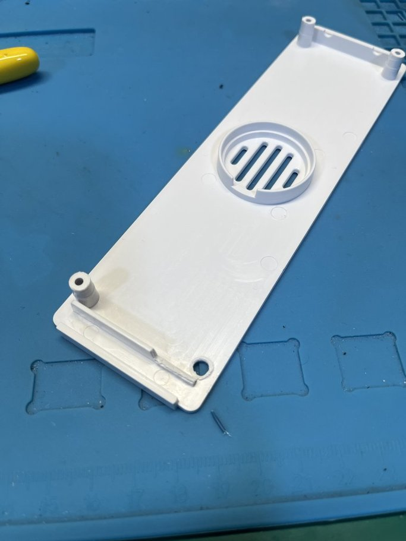

ESP32-C3 SuperMini to HU-058 MCU footprint wiring

Based on the clock project done by Adrian from the youtube channel Adrians digital basement https://youtu.be/vgfV_IGmhGA?si=nM0Irj1oQnthL4y8

This project is based on the cheaper of the 2 clocks the one that just uses the rtc chip and STC8G1K17 the code was changed from the original repo using claude so that it would fully rely only on the esp32 super mini and not have to rely on home assistant or anything further and just works stand alone.

From the kit all you will need is to solder the following items onto the pcb

## Install from the kit

- **SW1, SW2** buttons
- **USB1** micro USB jack (power in)
- **C3** 100 nF, beside the MCU footprint: decouples +5V where the SuperMini lands
- **C4** 100 nF: decoupling on the +5V rail

The display side comes assembled. Nothing else is needed. Solder all those parts first then I recommend some uv cure glue the first step will be to cover the power contacts on the original board we will be powering this clock using the esp32 itself.

## Follow the diagram below to hook up the esp32 super mini to the board and change the ssid and password in the firmware to your own and flash it to the board using arduino studio

once it is wired in you can position the esp32 super mini in the corner of the board where the power usb would normally go and use uv adhesive again to bond the super mini to the other circuit board.

After curing the uv adhesive the boards should not move and be locked together and you are almost done you will need to cut away a bit from the case to fit the new height of the port and be careful you cut the right parts you can see in the picture you will need to cut 1 of the screw posts and the plastic wall area if you want to be neat you can spend time with a rotary tool to make it fit or use side cutters like i did.

Please note this may not do all that the original firmware Adrian made its more of a compact version of it to just tell the time and stuff and control the rgb. To control everything you can go to the clocks ip or use the mdns that is set in the firmware. If you build more then 1 of these clocks i recommend changing the mdns name so they do not clash on the network. Finally once done you can screw the whole thing back together.

## Issues and notes

I have not tested the ota update feature so not sure if it works and most of the other features in the firmware besides ntp accuracy and changing colors and such.

Note that i use uv cure adhesive i recommend this over superglue as it works better to bond the 2 pcb boards together but you will need the glue and some sort of uv cure light to cure said adhisive.

